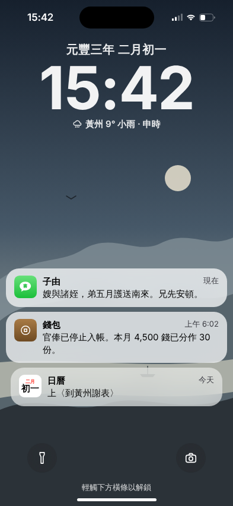
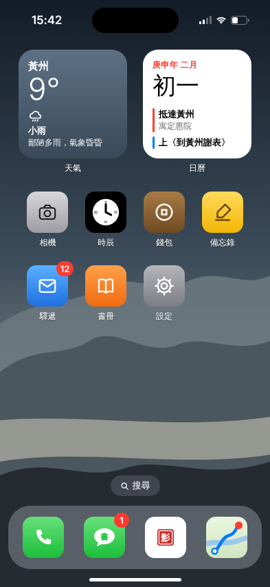
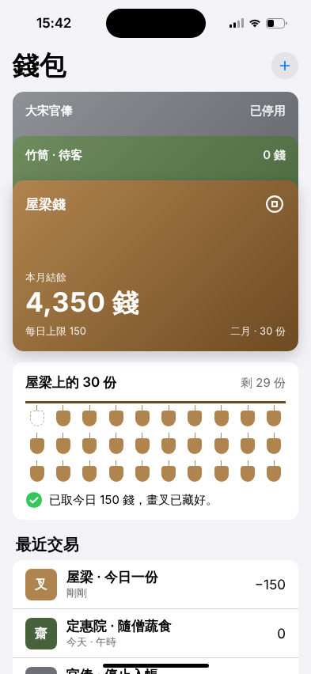

# 古人的手機 · Ancient Phone

一支高度仿真的 iPhone，裡面裝的是古人的生活。

第一支：**蘇軾的 iPhone**，時間停在元豐三年二月初一（1080）——烏臺詩案出獄後，他剛到黃州的那天。

<p>
  
  
  
  
</p>

- **鎖定畫面**：「官俸已停止入帳」的錢包通知、今日待上的〈到黃州謝表〉
- **訊息**：子由的上書與獄中訣別詩、與文與可為畫竹鬥嘴、家人燒稿、獄卒梁成、岐亭偶遇方山子、湖州被捕
- **通訊錄**：十二位聯絡人和「我的名片」，各有一張卡通頭像（陳慥的方山冠、梁成的熱水壺、皇甫僎的展腳幞頭）；備註是蘇軾自己的口吻（「授權費：0」），註釋附上根據
- **相簿**：一〇八〇年沒有相機，每張照片是一個字：湖、烏、獄、魚、陳、岐、江…
- **地圖**：湖州押解入京 → 汴京出獄 → 南下黃州
- **錢包**：〈答秦太虛書〉的屋梁錢——四千五百錢分三十份，每天用畫叉挑一份
- **備忘錄**：到黃州待辦清單、〈卜算子〉草稿

手機上預設只顯示原文。右上角「白話」會把畫面上的原文就地換成白話（再按「原文」切回）；「註釋」打開一整頁的註釋與出處。

## 執行

```bash
npm install
npm run dev
```

打開 http://localhost:5173 。用 `?figure=<id>` 切換人物。

## 新增人物

見 [CLAUDE.md](./CLAUDE.md#adding-a-figure)。所有內容都在 `src/figures/<id>.ts`，UI 元件不含任何人物資料。

## 部署

`npm run build` 產出的 `dist/` 是純靜態網站，可放在任何靜態主機。repo 內附 GitHub Pages workflow（`.github/workflows/pages.yml`，手動觸發）；公開 repo 或付費方案可直接使用。

---

App 圖示為原創設計，僅借用 iOS 的視覺語彙，非 Apple 官方素材。
